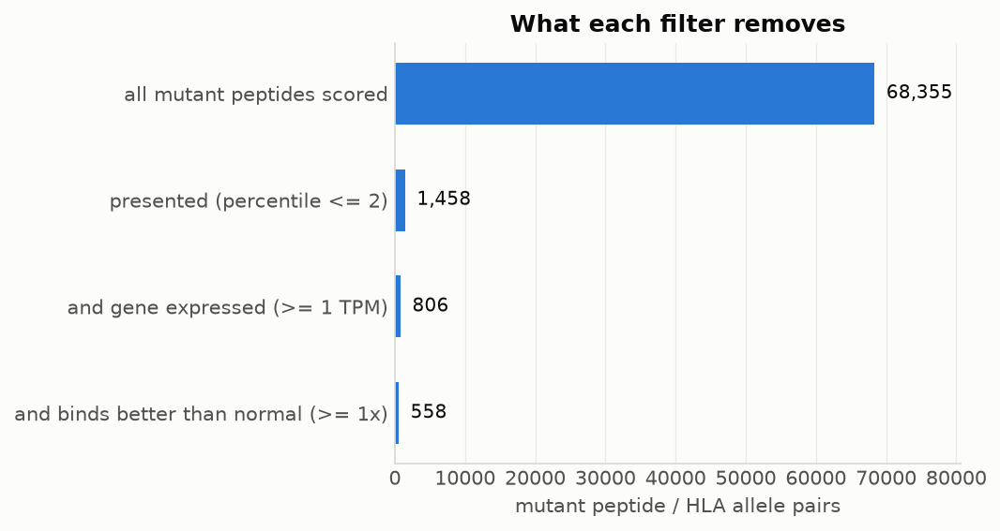
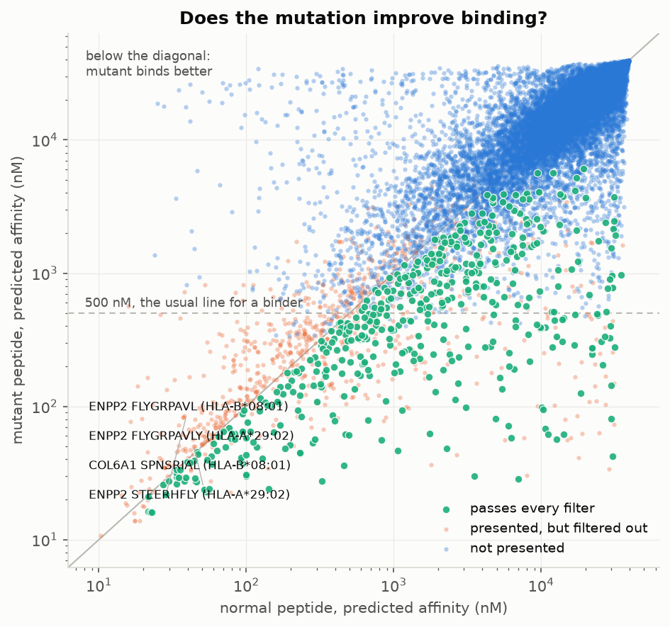
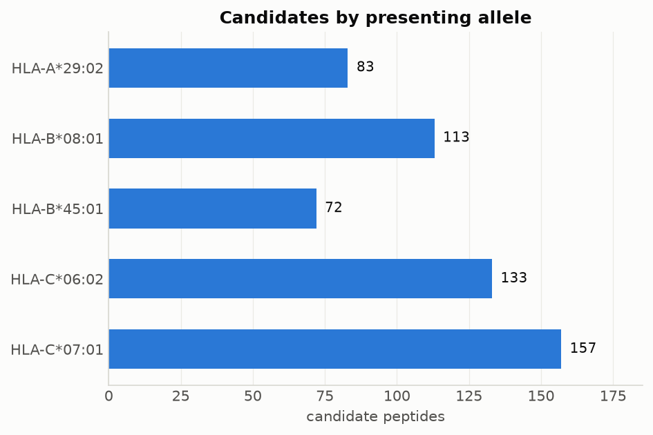

# neoantigen-pipeline

From a tumour's somatic mutations and its RNA-seq to the mutant peptides its own HLA class I molecules could put on display.

## Why neoantigens

A tumour carries mutations that the patient's healthy cells do not. When a mutated protein is broken down inside the cell, some of the fragments are loaded onto MHC class I molecules and shown on the cell surface, where a T cell can see that something is wrong. Fragments like that are called neoantigens, and they are what personalised cancer vaccines are made of: sequence the tumour, work out which mutant peptides are likely to be presented, and put a handful of the best ones into a vaccine for that one patient.

The difficult part is "likely to be presented". A tumour genome holds tens of thousands of somatic variants, and only a tiny number of them end up as a peptide that is both tumour-specific and able to sit in the groove of one of that patient's own HLA molecules. This repository is my own implementation of that selection, from VCF to a ranked shortlist, written so that every step can be checked.

Real projects use established tools for this, above all [pVACtools](https://pvactools.readthedocs.io/). I wrote this from scratch because I wanted to understand each step myself rather than trust a wrapper: how a genomic coordinate becomes a residue in a protein, why the self filter matters, and what each threshold throws away.

## Questions

1. Which somatic variants in a tumour actually change a protein?
2. Which of the resulting mutant peptides are predicted to be presented by that tumour's own HLA class I alleles?
3. How much does each filter remove: presentation, gene expression, and binding better than the normal peptide?

## Approach

```
somatic VCFs (SNVs + indels)        Ensembl: GTF + CDS + protein FASTA
            │                                  │
            └──────────────┬───────────────────┘
                           ▼
       Annotation: find the coding blocks the variant falls in,
       apply it in coding orientation, translate, and compare with
       the normal protein  ->  missense / frameshift / in-frame indel /
       synonymous / stop gained / stop lost
                           ▼
       Peptides: every 8 to 11 residue window that covers the change
                           ▼
       Self filter: drop windows that also occur anywhere in the
       normal proteome, isoforms included (not tumour-specific)
                           ▼
       Presentation: MHCflurry 2 for each of the sample's HLA class I
       alleles, for the mutant peptide and its normal counterpart
                           ▼
       Filters and ranking: presented (percentile <= 2), gene expressed
       (>= 1 TPM), and binds at least as well as the normal peptide
                           ▼
       ranked candidates + figures
```

Three checks are built into the annotation step, because a quiet coordinate error there would invent peptides that do not exist:

* a transcript is only used if its coding blocks on the chromosome add up to the length of its coding sequence, and if translating that sequence reproduces exactly the protein Ensembl distributes;
* the reference allele in the VCF has to match the reference base in the coding sequence, in coding orientation;
* indels that run from an exon into an intron are skipped rather than guessed at, because the consequence then depends on splicing.

### Testing on simulated data first

Before using real data I run the pipeline on ten toy genes on a toy chromosome, written out as an Ensembl-style GTF, coding and protein FASTA files, and VCFs, so the real code runs on them unchanged. Each gene carries one planted variant, and `scripts/check_test_results.py` compares the output with what was planted:

| Planted | What the pipeline has to do |
| --- | --- |
| missense, plus strand | call it missense, name the right protein change, and give peptides that differ from the normal peptide at exactly one position |
| missense, minus strand | the same, which only works if the strand handling is right |
| synonymous | call it synonymous and produce no peptides |
| missense in a gene with 0 TPM | produce peptides, then lose them at the expression filter |
| 1 bp insertion | call it a frameshift and claim no normal counterpart for the peptides |
| 3 bp deletion, minus strand | call it an in-frame deletion and produce peptides |
| nonsense | call it stop gained and produce no peptides |
| missense whose peptide also occurs in another gene's normal protein | remove it in the self filter |
| reference allele that does not match the reference | skip it and say why |
| variant in an intron | not annotate it on any transcript |
| deletion running from an exon into an intron | skip it and say why |
| two published HLA-A\*02:01 epitopes | rank them in the top 5 |

The last row is a positive control for the binding step rather than for the annotation: the CMV pp65 peptide NLVPMVATV and the influenza A M1 peptide GILGFVFTL are known to be presented by HLA-A\*02:01, so if the predictions are wired up correctly they should come out at the top. They are planted one residue away from the real epitope, so that a single base change creates them.

## How to run

```bash
conda env create -f environment.yml
conda activate neoantigen-pipeline

./run_pipeline.sh --test   # simulated data, then check the answers (about 2 min)
./run_pipeline.sh          # HCC1395, downloading about 600 MB on the first run
```

The MHCflurry models (about 100 MB) are fetched on first use. Everything else is downloaded by step 1: the Ensembl 110 reference, the SEQC2 somatic truth set, and the expression table.

## Input

| What | Where it comes from |
| --- | --- |
| somatic SNVs and indels | SEQC2 high-confidence truth set for HCC1395 (GRCh38) |
| HLA class I genotype | `config/hla.tsv`: the published typing of HCC1395 |
| gene expression | RNA-seq of the same cell line, from Expression Atlas E-MTAB-2706 |
| transcripts and proteins | Ensembl release 110, canonical protein-coding transcripts |

Thresholds live in `config/settings.yaml`.

## Output

| File | Content |
| --- | --- |
| `results/candidates.tsv` | the ranked shortlist: peptide, allele, scores, expression, the variant it comes from |
| `results/variants.tsv` | every variant with its consequence and protein change |
| `results/peptides.tsv` | every mutant peptide that survived the self filter |
| `results/annotation_summary.tsv`, `results/peptide_summary.tsv` | counts per consequence, and what was skipped and why |
| `results/all_scored_peptides.tsv.gz` | all peptide/allele pairs with their scores, before filtering |
| `results/filter_funnel.png` | how many peptide/allele pairs each filter removes |
| `results/mutant_vs_normal_affinity.png` | mutant against normal predicted affinity |
| `results/candidates_per_allele.png` | which allele accounts for which candidates |
| `results/summary.tsv` | the numbers behind the funnel |

## What this does not do

* **Class I only.** CD4 T cells see class II peptides, which are longer and predicted by other models.
* **Predictions, not measurements.** MHCflurry predicts presentation from sequence. It says nothing about whether a T cell receptor exists that recognises the peptide, which is the part that decides whether a vaccine works.
* **The HLA type is taken from the literature**, not called from the reads. A clinical pipeline would type HLA from the sequencing data itself, with a tool such as OptiType or arcasHLA.
* **Expression is gene-level, from a different experiment** on the same cell line, so it shows that the gene is transcribed, not that the mutant allele is. Checking whether the mutation itself is expressed needs RNA-seq reads from the same sample.
* **Canonical transcripts only**, one per gene. A variant that matters only in another isoform is missed.
* **Splice-site variants and stop-lost variants are reported but not translated further.** Both need sequence this pipeline does not load.
* **No clonality.** The variant allele frequency is carried through to the output but is not used for ranking, and a subclonal mutation is a weaker target than a clonal one.

## Results on HCC1395

HCC1395 is a breast cancer cell line that the SEQC2 consortium sequenced many times over to build a reference set of somatic mutations, which makes it a good test case: the variants are agreed on, and both the HLA type and RNA-seq of the line are published. Its five class I alleles are HLA-A\*29:02 (homozygous), B\*08:01, B\*45:01, C\*06:02 and C\*07:01.

**From 41,072 somatic variants to 395 peptides.** Of the 39,447 high-confidence SNVs and 1,625 indels, 453 fall in the coding part of a canonical transcript (458 variant/transcript pairs, because a few sit in two overlapping genes), and most of those do nothing interesting:

| | |
| --- | --- |
| missense | 318 |
| synonymous | 109 |
| stop gained | 16 |
| frameshift | 10 |
| in-frame deletion | 4 |
| stop lost | 1 |

The 332 variants that change a protein without truncating it give 13,875 peptide windows, of which 204 are thrown out because they also occur somewhere in the normal proteome. Scoring the remaining 13,671 peptides against all five alleles gives 68,355 peptide/allele pairs, and the filters then cut that down hard:



What is left is **558 peptide/allele pairs, 395 distinct peptides from 127 genes**: 332 from missense variants, 53 from frameshifts and 10 from in-frame deletions. Frameshifts are worth their own line here. They are only 10 of the variants but produce 53 of the candidates, because a frameshift replaces the whole C-terminus with sequence that has never existed in a human protein, so almost every window over it is tumour-specific.

The top of the list:

| rank | gene | peptide | allele | affinity (nM) | mutant vs normal | TPM | VAF |
| --- | --- | --- | --- | --- | --- | --- | --- |
| 1 | ENPP2 | FLYGRPAVL | B\*08:01 | 22 | 1.3x | 7 | 0.07 |
| 5 | COL6A1 | SPNSRIAL | B\*08:01 | 38 | 1.1x | 387 | 0.08 |
| 7 | ADPRHL1 | QENWFYFEA | B\*45:01 | 33 | 1.1x | 4 | 0.54 |
| 8 | DBN1 | SEVEKAAAIIA | B\*45:01 | 26 | 1.1x | 68 | 0.30 |
| 9 | MPG | FFDQPAVHL | B\*08:01 | 31 | 3.3x | 92 | 0.14 |



Two things in that table are worth being honest about. The top-ranked peptide comes from a variant present in only 7% of the tumour reads, so it is probably subclonal and a poor vaccine target however well it binds; ranking on presentation alone does not see that. And the mutant-to-normal ratios are mostly close to 1, meaning the mutation barely changes the binding: the peptide was already a good binder and the mutation happens to sit in it.

**Two checks against what is already known.** The pipeline finds the TP53 p.R175H substitution that Cellosaurus lists for this cell line, homozygous, at a variant allele frequency of 0.99. It then does *not* put it forward as a candidate, and that is the right answer: the published R175H neoepitope HMTEVVRHC is presented by HLA-A\*02:01, which HCC1395 does not carry. Scored against the alleles this cell line actually has, the same peptide comes out at 3,211 to 31,720 nM, far too weak to be presented. A pipeline that reported a famous neoantigen regardless of the patient's HLA type would be worse than useless, and this is the kind of mistake the HLA step exists to prevent.



The candidates are spread over all five alleles, with the two HLA-C alleles accounting for more than half of them. That is partly real and partly a quirk of the data MHCflurry was trained on, which contains less HLA-C than HLA-A and HLA-B.

## References

* Fang LT et al. (2021) Establishing community reference samples, data and call sets for benchmarking cancer mutation detection using whole-genome sequencing. *Nat Biotechnol* 39:1151-1160. The SEQC2 truth set.
* O'Donnell TJ, Rubinsteyn A, Laserson U (2020) MHCflurry 2.0: improved pan-allele prediction of MHC class I-presented peptides by incorporating antigen processing. *Cell Syst* 11:42-48.
* Klijn C et al. (2015) A comprehensive transcriptional portrait of human cancer cell lines. *Nat Biotechnol* 33:306-312. The RNA-seq behind E-MTAB-2706.
* Boegel S et al. (2014) A catalog of HLA type, HLA expression, and neo-epitope candidates in human cancer cell lines. *OncoImmunology* 3:e954893.
* Scholtalbers J et al. (2015) TCLP: an online cancer cell line catalogue integrating HLA type, predicted neo-epitopes, virus and gene expression. *Genome Med* 7:118.
* Hundal J et al. (2020) pVACtools: a computational toolkit to identify and visualize cancer neoantigens. *Cancer Immunol Res* 8:409-420.
* Cellosaurus entry for HCC1395: [CVCL_1249](https://www.cellosaurus.org/CVCL_1249), for the HLA typing and the TP53 variant.
